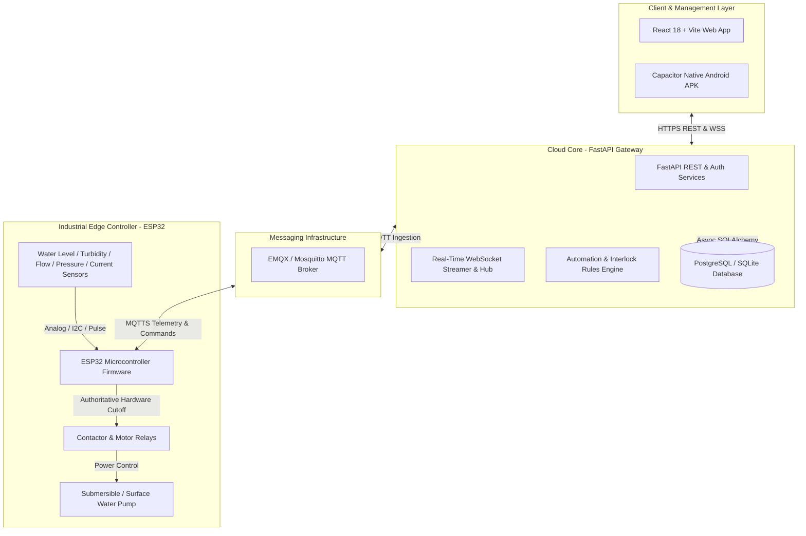

# HydraControl — Commercial IoT Smart Water Motor Automation Platform

**Developed by Kvon Tech Pvt Ltd**

HydraControl is a mission-critical, enterprise-grade IoT platform engineered for industrial water stations, municipal utilities, commercial facilities, and residential multi-tank water pump automation.

The platform provides end-to-end edge-to-cloud telemetry, authoritative local safety fail-safes, real-time WebSocket telemetry visualization, scheduled motor control, and multi-tenant access control (Enterprise & Home tiers).

---

## 🏛️ System Architecture



### Core Architecture Tenets
1. **Cloud Decides, Edge Protects:** Remote operational commands originate from the cloud application, but authoritative local hardware safety (dry run prevention, high-turbidity cutoff, tank overflow cutoff, thermal overload) executes immediately on the ESP32 edge microcontroller even if internet connectivity drops.
2. **Explicit Command State Machine:** Every command transitions deterministically: `PENDING` → `SENT` → `ACK` → `EXECUTED` / `FAILED`, with automatic watchdogs preventing stuck motor commands.
3. **Multi-Tenant Hierarchical Isolation:** Enforces strict role-based data isolation across **Organization → Site → Station → Controller → Motors / Sensors**.
4. **Resilient Real-Time Sync:** Telemetry and motor states stream via WebSockets with heartbeat detection and automatic reconnect fallbacks.

---

## 📂 Repository Layout

```
water-pump-automation/
├── backend/                    # FastAPI Backend Gateway
│   ├── app/
│   │   ├── api/v1/             # REST API routes (Motors, Sensors, Auth, Rules, etc.)
│   │   ├── core/               # App configuration, security, JWT, rate limiting
│   │   ├── db/                 # Database engine, session factories, base models
│   │   ├── models/             # SQLAlchemy ORM relational models
│   │   ├── schemas/            # Pydantic request/response validation schemas
│   │   ├── services/           # Business logic & domain services
│   │   ├── mqtt/               # MQTT client, topic router, message handlers
│   │   ├── websocket/          # Real-time WebSocket connection hub & streamer
│   │   ├── automation/         # Automation rules and scheduled operations
│   │   └── main.py             # Application startup and ASGI entry point
│   ├── alembic/                # Database migrations
│   ├── tests/                  # Pytest regression, chaos, load, & E2E suites (500+ tests)
│   └── requirements.txt        # Python dependencies
├── frontend/                   # React 18 + TypeScript + Vite + Tailwind Dashboard
│   ├── android/                # Capacitor Android native project & Gradle build
│   ├── public/                 # Static assets, logos, and manifests
│   ├── src/                    # Components, hooks, services, context, i18n
│   ├── package.json            # Node.js dependencies
│   └── vite.config.ts          # Vite build configuration
├── firmware/                   # Industrial ESP32 Controller Firmware (C++ / Arduino)
│   ├── HydraControl_ESP32/     # Arduino IDE sketch
│   ├── src/                    # PlatformIO C++ source
│   ├── include/                # Header files (Safety Engine, MQTT Client, Config)
│   └── platformio.ini          # PlatformIO board definitions & libraries
├── device_simulator/           # Complete software simulator for ESP32 edge testing
├── infra/                      # Docker Compose, Nginx reverse proxy, Mosquitto configs
├── docs/                       # Engineering manuals, BOM, schematic, FAT checklist
├── apk/                        # Compiled production Android APK installer
├── docker-compose.yml          # Local multi-container orchestration
└── run_backend.bat / run_frontend.bat # Rapid local launcher scripts
```

---

## 🚀 Quickstart Guide

### 1. Prerequisites
- **Python:** 3.11 or 3.12
- **Node.js:** 18 or 20 LTS
- **Git**

### 2. Backend Setup
```bash
# 1. Navigate to backend directory
cd backend

# 2. Create and activate virtual environment
python -m venv venv
# Windows:
.\venv\Scripts\activate
# Linux/macOS:
# source venv/bin/activate

# 3. Install dependencies
pip install -r requirements.txt

# 4. Copy environment template
cp ../.env.example ../.env

# 5. Start the FastAPI backend server
uvicorn app.main:app --reload --port 8000
```
API Documentation will be live at: `http://localhost:8000/docs`

### 3. Frontend Setup
```bash
# 1. Navigate to frontend directory
cd frontend

# 2. Install dependencies
npm install

# 3. Copy frontend environment template
cp .env.example .env

# 4. Start Vite development server
npm run dev
```
Dashboard will be live at: `http://localhost:5173`

### 4. Running the ESP32 Hardware Simulator
Test the entire end-to-end loop without physical hardware:
```bash
python device_simulator/esp32_simulator.py
```

---

## 📱 Mobile App (Android)

HydraControl includes a full native Android app built using Capacitor.

1. **Prebuilt APK:** Direct installation package available in `apk/HydraControl-Universal-v1.0.apk`.
2. **Build from source:**
   ```bash
   cd frontend
   npm run build
   npx cap sync android
   cd android
   # Windows:
   gradlew.bat assembleRelease
   # Linux/macOS:
   # ./gradlew assembleRelease
   ```
   Built APK will be generated at: `frontend/android/app/build/outputs/apk/release/`.

---

## 🧪 Testing & Verification

HydraControl features a 500+ test regression suite covering unit, integration, RBAC, safety, and chaos resiliency.

```bash
# Run complete test suite
pytest backend/tests/ -v

# Run safety diagnostics tests
pytest backend/tests/test_wave2_safety_integration.py -v

# Run Chaos & Resiliency tests
pytest backend/tests/chaos_tests/test_chaos.py -v
```

---

## 🛡️ License & Ownership

Copyright © 2026 **Kvon Tech Pvt Ltd**. All rights reserved.  
Confidential and Proprietary. Unauthorized distribution or reproduction is strictly prohibited.
